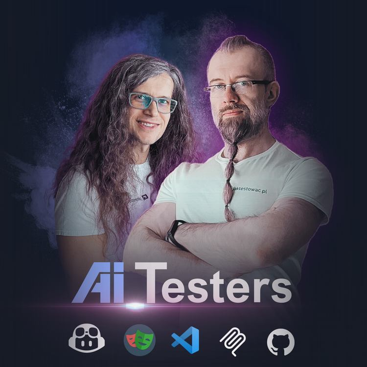
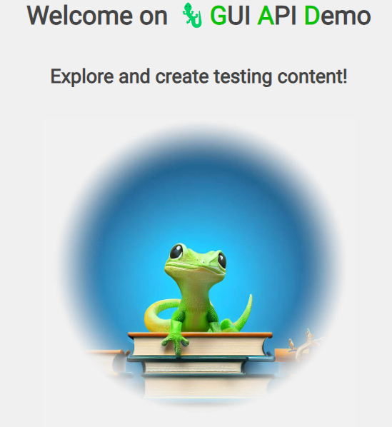

<a id="introduction"></a>

<div align="center">



<br/>

<a href="https://github.com/jaktestowac/gad-gui-api-demo/stargazers"></a>
<a href="https://github.com/jaktestowac/gad-gui-api-demo/network/members"></a>
<a href="https://hub.docker.com/r/jaktestowac/gad"></a>
<a href="https://discord.gg/mUAqQ7FUaZ"></a>

<a href="https://github.com/jaktestowac/gad-gui-api-demo/releases"></a>
<a href="https://nodejs.org"></a>
<a href="./LICENSE"></a>

<br/>

**🇬🇧 [English](./README.md)** &nbsp;·&nbsp; 🇵🇱 [Polski](./README.pl.md)

<br/>

### 🦎 A playground app for testers, packed with deliberate bugs 🐛

<sub>GUI · REST API · WebSockets · Swagger · feature flags · bug flags · games · and some <b>serious design flaws</b>. Can you spot them? 😉</sub>

</div>


## ⚡ Quick start

```bash
git clone https://github.com/jaktestowac/gad-gui-api-demo.git
cd gad-gui-api-demo
npm i
npm run start
```

> [!IMPORTANT]
> Open **[http://localhost:3000](http://localhost:3000)** and start testing and automating **🦎 GAD**.
>
> Prefer containers? &nbsp;`docker run -p 3000:3000 -d jaktestowac/gad`



## 🧭 Table of Contents

<table>
<tr>
<td valign="top">

**🚀 Explore**

- [What is GAD?](#-what-is-gad)
- [Module map](#module-map)
- [Features](#-features)

</td>
<td valign="top">

**🛠️ Deploy**

- [Local](#-deploy-on-local) *(recommended)*
- [CLI options](#cli-options)
- [Docker](#-deploy-using-docker-image)
- [Render](#deploy-to-render)
- [Glitch](#-deploy-to-glitch-obsolete) *(obsolete)*

</td>
<td valign="top">

**💚 Community**

- [Happy Automation!](#-happy-automation)
- [Contact & Support](#-contact--support)
- [Learning Resources](#-learning-resources)

</td>
</tr>
</table>


## 🦎 What is GAD?

**GAD** was prepared and developed **only for testing purposes**. It's a full-stack sandbox that combines a graphical user interface, a REST API and integrated Swagger documentation, and it is intentionally built with **deliberate bugs** 🐛 and challenges that simulate the complexity of real-world projects.

It's ideal for:

| 🎯 | Who / what |
| :-: | :-- |
| 🧑‍💻 | **Learning test automation** with Playwright, Cypress, Selenium, Postman, Supertest… |
| 🔍 | **Refining QA techniques**: exploratory testing, bug hunting, API contract checks |
| 🏗️ | **Building frameworks** against realistic, multi-domain applications |
| 🎤 | **Workshops & interviews**: reproducible datasets and toggleable bugs |

<a id="module-map"></a>

## 🗺️ Module map

<div align="center">

</div>

## ✨ Features

<table>
<tr>
<td width="50%" valign="top">

### 📝 Testers Blog
The main domain of the app.
- **Resources**: articles, users, comments, labels, bookmarks, flashposts
- **Engagement**: likes, comments, tags
- **Insights**: statistics and charts (likes per user, comments per article…)
- **Authentication** and **authorization** with user roles

</td>
<td width="50%" valign="top">

### 🧪 Practice Pages
180+ pages of automation challenges:
- iframes, file uploads, drag & drop
- dynamic elements, banners, pop-ups
- 2-factor authentication, captcha
- labels, surveys, front-end and back-end logic
- and many more tricky widgets

</td>
</tr>
<tr>
<td valign="top">

### 🧩 Sub-applications
Complete mini-products to test end to end:
- 📚 **Book Shop**: catalogue, orders, payments, roles
- 🎓 **Learning**: courses, lessons, progress, certificates
- 💬 **GadTalk**: a social network with feeds and followers
- 🐞 **Bug Hatch**: an issue tracker with analytics
- 📈 **Projects**: dashboards and ROI calculators

</td>
<td valign="top">

### 🎮 Games Arcade
25+ games with scores and high scores:
- Sudoku, Minesweeper, Maze, Hangman
- Tic-tac-toe (hot-seat, bot, API-driven)
- Quiz, Memorizer, Pong, Bug Eater, Regex Challenge…
- Perfect for testing canvas, timing and state

</td>
</tr>
<tr>
<td valign="top">

### ⚙️ Dynamic configuration
Adjust the application **easily from the UI**:
- 🚩 **Feature flags**: enable or disable features
- 🐛 **Bug flags**: inject or remove bugs on demand
- 🔒 **Read-only mode**, custom port, SSL
- 🗃️ Multiple **datasets** (tiny → big, empty, interview)

</td>
<td valign="top">

### 🛠️ Admin Backoffice & API
- 💾 **Database reset / restore** via REST endpoints
- 🧮 **SQL playground** for experimenting with queries
- 📘 **Swagger documentation** for the whole API
- ⚡ **REST + WebSockets** back-end
- 🛰️ Standalone **microservices** (QR, hasher, URL shortener, GraphQL to-do…)

</td>
</tr>
</table>


## 🚀 Deployment

| Method | Best for | Status |
| :-- | :-- | :-: |
| 💻 [Local](#-deploy-on-local) | Everyday learning and development | ✅ **Recommended** |
| 🐋 [Docker](#-deploy-using-docker-image) | Local runs & CI/CD pipelines | ✅ |
| ☁️ [Render](#deploy-to-render) | One-click cloud demo | ⚠️ Partial |
| 🎏 [Glitch](#-deploy-to-glitch-obsolete) | – | ❌ Obsolete |

### 💻 Deploy on Local

**Requirements**

- **node.js** installed (tested on **v20** and **v22**)
- **git** installed

#### First use

1. Open the project root directory in cmd/terminal
1. Clone the repository using `git clone ...`
   - this is the **preferred way** to use this application
1. Run `npm i`
   - to install modules (don't use node.js global packages!)
1. Run `npm run start`
   - to start GAD

The application will be available at `http://localhost:3000`

#### Update version

<details>
<summary><b>📦 If you are using the zip package</b></summary>

<br/>

1. Download the zipped repository
1. Unzip and replace your local instance of GAD
1. Run `npm i` in the root directory
   - to install new modules
1. Run `npm run start`
   - to start GAD

</details>

<details>
<summary><b>🌿 If you are using a cloned repository</b></summary>

<br/>

1. Open the project root directory in cmd/terminal
1. Pull the latest changes using `git pull`
1. Run `npm i`
   - to install new modules
1. Run `npm run start`
   - to start GAD

</details>

<details>
<summary><b>♻️ If you have local changes (e.g. in the database)</b></summary>

<br/>

One possibility is to reset all your local changes and pull the new version. Using this method **you will lose all your local changes and data**!

1. Open the project root directory in cmd/terminal
1. Reset local changes and pull the latest changes using:
   ```
   git reset --hard HEAD
   git pull
   ```
1. Run `npm i`
   - to install new modules
1. Run `npm run start`
   - to start GAD

</details>

<a id="cli-options"></a>

### ⌨️ CLI options

> [!TIP]
> CLI (Command Line Interface) is an interface that allows you to interact with the application using commands in the terminal.

| Option | Description |
| :-- | :-- |
| `READ_ONLY=1` | Run in Read Only mode. This disables all POST, PUT, and PATCH methods, besides login. |
| `PORT=3001` | Run on selected port. GAD runs on default port `3000`. |
| `DB="db_name"` | Use selected database file. GAD uses `db.json` as default database. Example (for PowerShell): `$env:DB="db-base-big"; npm run start` |

> [!WARNING]
> ⚠️ Any environment variables set in the terminal will be used by the application. If you want to run the application without any options, make sure to clear the environment variables.

**Running with CLI options**, e.g.:

<table>
<tr><th>PowerShell</th><th>Bash</th><th>Windows Cmd</th></tr>
<tr>
<td>

```powershell
$env:PORT=3001; npm run start
```

</td>
<td>

```bash
PORT=3001 npm run start
```

</td>
<td>

```bat
set PORT=3001 && npm run start
```

</td>
</tr>
</table>

### 🐋 Deploy using Docker image

This method can be used locally and in CI/CD services (GitHub Actions, GitLab CI etc.).

**Prerequisites:** the latest Docker installed.

Get the latest image:

```bash
docker run -p 3000:3000 -d jaktestowac/gad
```

or a specific version:

```bash
docker run -p 3000:3000 -d jaktestowac/gad:2.5.5
```

The application should be running at http://localhost:3000/

Images are available at: [🐋 hub.docker.com/r/jaktestowac/gad](https://hub.docker.com/r/jaktestowac/gad)

<a href="https://hub.docker.com/r/jaktestowac/gad/tags"></a>
<a href="https://hub.docker.com/r/jaktestowac/gad"></a>
<a href="https://hub.docker.com/r/jaktestowac/gad/tags"></a>

<a id="deploy-to-render"></a>

### ☁️ Deploy to Render

Render is a popular Heroku-like PaaS with a free tier and a "Deploy to Render" button for one-click deploys.

1. Create a free account at https://dashboard.render.com/register
1. After successful registration, hit the button:

   [](https://render.com/deploy?repo=https://github.com/jaktestowac/gad-gui-api-demo)

1. Name your app
1. Hit `Apply`
1. Wait a while and click the link to the project `GUI API Demo`
1. Click the link to open the app (under the project name and repository)
1. Enjoy 750 free hours of service per month

> [!NOTE]
> When deploying GAD on Render, the application may not function fully due to the limitations of the Render platform. However, we are making every effort to ensure the highest possible compatibility.

### 🎏 Deploy to Glitch (obsolete)

> [!WARNING]
> **⚠️ This deployment method is obsolete and no longer recommended.**
>
> Glitch has changed their [platform policies](https://blog.glitch.com/post/changes-are-coming-to-glitch/) and this deployment method may no longer work as expected. Please use one of the other deployment methods instead.

<details>
<summary>Legacy instructions</summary>

<br/>

~~No account needed - but your project will be deleted in 5 days.~~

~~After clicking the button below, wait a minute or two to finish deployment.~~

~~[](https://glitch.com/edit/#!/import/github/jaktestowac/gad-gui-api-demo)~~

~~To see the website: go to the bottom buttons, click `🔎PREVIEW`, choose `👯Preview in a new window`.~~

</details>


## 🎉 Happy Automation!

We hope you'll have a great time testing and automating this application! The challenges and features are designed to help you grow your testing skills while having fun.

If you have ideas for improvements or encounter any issues, please open an issue on our [GitHub repository](https://github.com/jaktestowac/gad-gui-api-demo/issues). Your feedback helps make GAD better for everyone!

📢 Looking forward to your contributions and happy testing! 🦎

## 📞 Contact & Support

<div align="center">

<a href="https://jaktestowac.pl"></a>
<a href="https://www.linkedin.com/company/jaktestowac/"></a>
<a href="https://discord.gg/mUAqQ7FUaZ"></a>
<a href="https://github.com/jaktestowac/gad-gui-api-demo/issues"></a>
<a href="https://github.com/jaktestowac/gad-gui-api-demo/graphs/contributors"></a>

</div>

- 📧 **Support**: check our website for contact details

## 📚 Learning Resources

We have gathered a collection of resources to help you learn and master Playwright, both in Polish and English. Whether you're a beginner or an advanced user, these resources will help you enhance your skills and knowledge.

### 🇵🇱 Polish Resources

- [TypeScript for Testers - Express Introduction](https://jaktestowac.pl/tsx/) - Free (4h+) course on TypeScript for Testers
- [JavaScript and TypeScript for Testers](https://jaktestowac.pl/js-ts/) - Comprehensive (13h+) course on JavaScript and TypeScript for testers, with practical examples and exercises
- [Professional Test Automation with Playwright](https://jaktestowac.pl/playwright/) - Comprehensive (100h+) course on Playwright, test automation, CI/CD and test architecture
- [Back-end Test Automation](https://jaktestowac.pl/api/) - Comprehensive (45h+) course on Back-end Test Automation with Postman, Mocha, Chai, and Supertest
- [Free Playwright Resources](https://jaktestowac.pl/darmowy-playwright/) - Comprehensive and Free Polish learning materials
- [Playwright Basics](https://www.youtube.com/playlist?list=PLfKhn9AcZ-cD2TCB__K7NP5XARaCzZYn7) - YouTube series (Polish)
- [Playwright Elements](https://www.youtube.com/playlist?list=PLfKhn9AcZ-cAcpd-XN4pKeo-l4YK35FDA) - Advanced concepts (Polish)
- [Playwright MCP](https://www.youtube.com/playlist?list=PLfKhn9AcZ-cCqD34AG5YRejujaBqCBgl4) - MCP course (Polish)
- [Discord Community](https://discord.gg/mUAqQ7FUaZ) - First Polish Playwright community!
- [Playwright Info](https://playwright.info/) - first and only Polish Playwright blog

#### 🤖 AI_Testers

<div align="center">
<a href="https://aitesters.pl">

</a>
</div>

Gain an edge by combining AI knowledge with the most popular tools in the IT market.
We'll show you how to accelerate with AI and build a professional test automation framework. 😉

- [AI_Testers](https://aitesters.pl) - Main page about AI_Testers Program
- [AI_Testers LinkedIn](https://www.linkedin.com/company/aitesters) - Follow us on LinkedIn

### 🇬🇧 English Resources

- [VS Code Extensions](https://marketplace.visualstudio.com/publishers/jaktestowac-pl) - Our free Playwright plugins

_PS. For more resources and updates, follow us on our [website](https://jaktestowac.pl) and [GitHub](https://github.com/jaktestowac)._


<div align="center">



**Powered by the [jaktestowac.pl](https://www.jaktestowac.pl) team** 💚❤️

[🔝 Back to top](#introduction)

</div>
