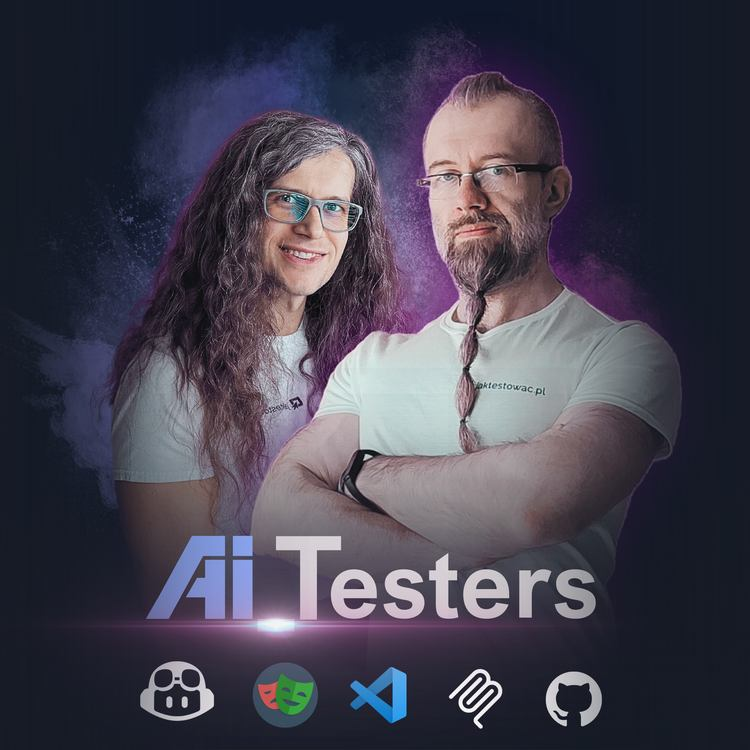
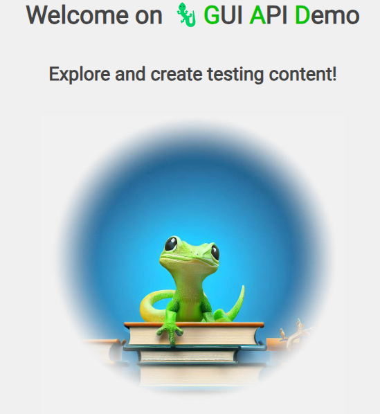

<a id="wprowadzenie"></a>

<div align="center">



<br/>

<a href="https://github.com/jaktestowac/gad-gui-api-demo/stargazers"></a>
<a href="https://github.com/jaktestowac/gad-gui-api-demo/network/members"></a>
<a href="https://hub.docker.com/r/jaktestowac/gad"></a>
<a href="https://discord.gg/mUAqQ7FUaZ"></a>

<a href="https://github.com/jaktestowac/gad-gui-api-demo/releases"></a>
<a href="https://nodejs.org"></a>
<a href="./LICENSE"></a>

<br/>

🇬🇧 [English](./README.md) &nbsp;·&nbsp; **🇵🇱 [Polski](./README.pl.md)**

<br/>

### 🦎 Aplikacja-poligon dla testerów, pełna celowo wprowadzonych błędów 🐛

<sub>GUI · REST API · WebSockets · Swagger · flagi funkcji · flagi błędów · gry · oraz kilka <b>poważnych wad w architekturze</b>. Zauważysz je? 😉</sub>

</div>


## ⚡ Szybki start

```bash
git clone https://github.com/jaktestowac/gad-gui-api-demo.git
cd gad-gui-api-demo
npm i
npm run start
```

> [!IMPORTANT]
> Otwórz **[http://localhost:3000](http://localhost:3000)** i zacznij testować oraz automatyzować **🦎 GAD**.
>
> Wolisz kontenery? &nbsp;`docker run -p 3000:3000 -d jaktestowac/gad`



## 🧭 Spis treści

<table>
<tr>
<td valign="top">

**🚀 Poznaj**

- [Czym jest GAD?](#czym-jest-gad)
- [Mapa modułów](#mapa-modulow)
- [Funkcje](#funkcje)

</td>
<td valign="top">

**🛠️ Wdrożenie**

- [Lokalnie](#wdrozenie-lokalne) *(zalecane)*
- [Opcje CLI](#opcje-cli)
- [Docker](#wdrozenie-docker)
- [Render](#wdrozenie-render)
- [Glitch](#wdrozenie-glitch) *(przestarzałe)*

</td>
<td valign="top">

**💚 Społeczność**

- [Miłej automatyzacji!](#milej-automatyzacji)
- [Kontakt i wsparcie](#kontakt-i-wsparcie)
- [Zasoby edukacyjne](#zasoby-edukacyjne)

</td>
</tr>
</table>


<a id="czym-jest-gad"></a>

## 🦎 Czym jest GAD?

**GAD** została przygotowana i stworzona **wyłącznie w celach testowych**. To pełnostackowa piaskownica, która łączy graficzny interfejs użytkownika, REST API i zintegrowaną dokumentację Swagger. Jest celowo zbudowana z **umyślnymi błędami** 🐛 i wyzwaniami, które symulują złożoność rzeczywistych projektów.

Idealna do:

| 🎯 | Dla kogo / do czego |
| :-: | :-- |
| 🧑‍💻 | **Nauki automatyzacji testów** z Playwright, Cypress, Selenium, Postman, Supertest… |
| 🔍 | **Doskonalenia technik QA**: testy eksploracyjne, polowanie na błędy, weryfikacja kontraktów API |
| 🏗️ | **Budowania frameworków** na realistycznej aplikacji z wieloma domenami |
| 🎤 | **Warsztatów i rekrutacji**: powtarzalne zestawy danych i przełączane błędy |

<a id="mapa-modulow"></a>

## 🗺️ Mapa modułów

<div align="center">

</div>

<a id="funkcje"></a>

## ✨ Funkcje

<table>
<tr>
<td width="50%" valign="top">

### 📝 Blog testerów
Główna domena aplikacji.
- **Zasoby**: artykuły, użytkownicy, komentarze, etykiety, zakładki, flashposty
- **Zaangażowanie**: polubienia, komentarze, tagi
- **Analityka**: statystyki i wykresy (polubienia na użytkownika, komentarze na artykuł…)
- **Uwierzytelnianie** i **autoryzacja** z rolami użytkowników

</td>
<td width="50%" valign="top">

### 🧪 Strony do ćwiczeń
Ponad 180 stron z wyzwaniami automatyzacji:
- iframe'y, przesyłanie plików, przeciągnij i upuść
- elementy dynamiczne, banery, pop-upy
- uwierzytelnianie dwuskładnikowe, captcha
- etykiety, ankiety, logika front-end i back-end
- i wiele innych podchwytliwych elementów

</td>
</tr>
<tr>
<td valign="top">

### 🧩 Podaplikacje
Kompletne mini-produkty do testów end-to-end:
- 📚 **Book Shop**: katalog, zamówienia, płatności, role
- 🎓 **Learning**: kursy, lekcje, postępy, certyfikaty
- 💬 **GadTalk**: sieć społecznościowa z feedem i obserwującymi
- 🐞 **Bug Hatch**: system zgłoszeń z analityką
- 📈 **Projects**: dashboardy i kalkulatory ROI

</td>
<td valign="top">

### 🎮 Salon gier
Ponad 25 gier z wynikami i rankingami:
- Sudoku, Saper, Labirynt, Wisielec
- Kółko i krzyżyk (hot-seat, z botem, przez API)
- Quiz, Memorizer, Pong, Bug Eater, Regex Challenge…
- Idealne do testowania canvas, zależności czasowych i stanu

</td>
</tr>
<tr>
<td valign="top">

### ⚙️ Dynamiczna konfiguracja
Dostosuj aplikację **łatwo z poziomu interfejsu**:
- 🚩 **Flagi funkcji**: włączaj i wyłączaj funkcje
- 🐛 **Flagi błędów**: wprowadzaj lub usuwaj błędy na żądanie
- 🔒 **Tryb tylko do odczytu**, własny port, SSL
- 🗃️ Wiele **zestawów danych** (od małych po duże, pusty, rekrutacyjny)

</td>
<td valign="top">

### 🛠️ Panel administracyjny i API
- 💾 **Reset / przywracanie bazy danych** przez endpointy REST
- 🧮 **Plac zabaw SQL** do eksperymentowania z zapytaniami
- 📘 **Dokumentacja Swagger** dla całego API
- ⚡ Back-end **REST + WebSockets**
- 🛰️ Niezależne **mikroserwisy** (QR, hasher, skracacz URL, to-do w GraphQL…)

</td>
</tr>
</table>


## 🚀 Wdrożenie

| Metoda | Najlepsza do | Status |
| :-- | :-- | :-: |
| 💻 [Lokalnie](#wdrozenie-lokalne) | Codziennej nauki i rozwoju | ✅ **Zalecane** |
| 🐋 [Docker](#wdrozenie-docker) | Uruchomień lokalnych i pipeline'ów CI/CD | ✅ |
| ☁️ [Render](#wdrozenie-render) | Demo w chmurze jednym kliknięciem | ⚠️ Częściowo |
| 🎏 [Glitch](#wdrozenie-glitch) | – | ❌ Przestarzałe |

<a id="wdrozenie-lokalne"></a>

### 💻 Wdrożenie lokalne

**Wymagania**

- **node.js** zainstalowany w systemie (przetestowane na **v20** i **v22**)
- **git** zainstalowany w systemie

#### Pierwsze użycie

1. Otwórz główny katalog projektu w cmd/terminalu
1. Sklonuj repozytorium używając `git clone ...`
   - to jest **preferowany sposób** używania tej aplikacji
1. Uruchom `npm i`
   - aby zainstalować moduły (nie używaj globalnych pakietów node.js!)
1. Uruchom `npm run start`
   - aby uruchomić aplikację **🦎 GAD**

Aplikacja będzie dostępna pod adresem `http://localhost:3000`

#### Aktualizacja wersji

<details>
<summary><b>📦 Jeśli używasz pakietu zip</b></summary>

<br/>

1. Pobierz spakowane repozytorium
1. Rozpakuj i zastąp swoją lokalną instancję GAD
1. Uruchom `npm i` w głównym katalogu
   - aby zainstalować nowe moduły
1. Uruchom `npm run start`
   - aby uruchomić GAD

</details>

<details>
<summary><b>🌿 Jeśli używasz sklonowanego repozytorium</b></summary>

<br/>

1. Otwórz główny katalog projektu w cmd/terminalu
1. Pobierz najnowsze zmiany używając `git pull`
1. Uruchom `npm i`
   - aby zainstalować nowe moduły
1. Uruchom `npm run start`
   - aby uruchomić GAD

</details>

<details>
<summary><b>♻️ Jeśli masz lokalne zmiany (np. w bazie danych)</b></summary>

<br/>

Jedną z możliwości jest zresetowanie wszystkich lokalnych zmian i pobranie nowej wersji. Używając tej metody **stracisz wszystkie swoje lokalne zmiany i dane**!

1. Otwórz główny katalog projektu w cmd/terminalu
1. Zresetuj lokalne zmiany i pobierz najnowsze zmiany używając:
   ```
   git reset --hard HEAD
   git pull
   ```
1. Uruchom `npm i`
   - aby zainstalować nowe moduły
1. Uruchom `npm run start`
   - aby uruchomić **🦎 GAD**

</details>

<a id="opcje-cli"></a>

### ⌨️ Opcje CLI

> [!TIP]
> CLI (Command Line Interface) to interfejs, który pozwala na interakcję z aplikacją za pomocą poleceń w terminalu.

| Opcja | Opis |
| :-- | :-- |
| `READ_ONLY=1` | Uruchom w trybie tylko do odczytu. To wyłącza wszystkie metody POST, PUT i PATCH, oprócz logowania. |
| `PORT=3001` | Uruchom na wybranym porcie. GAD działa domyślnie na porcie `3000`. |
| `DB="db_name"` | Użyj wybranego pliku bazy danych. GAD używa `db.json` jako domyślnej bazy danych. Przykład (dla PowerShell): `$env:DB="db-base-big"; npm run start` |

> [!WARNING]
> ⚠️ Wszystkie zmienne środowiskowe ustawione w terminalu będą używane przez aplikację. Jeśli chcesz uruchomić aplikację bez żadnych opcji, upewnij się, że wyczyściłeś zmienne środowiskowe.

**Uruchamianie z opcjami CLI**, np.:

<table>
<tr><th>PowerShell</th><th>Bash</th><th>Windows Cmd</th></tr>
<tr>
<td>

```powershell
$env:PORT=3001; npm run start
```

</td>
<td>

```bash
PORT=3001 npm run start
```

</td>
<td>

```bat
set PORT=3001 && npm run start
```

</td>
</tr>
</table>

<a id="wdrozenie-docker"></a>

### 🐋 Wdrożenie za pomocą obrazu Docker

Ta metoda może być używana lokalnie oraz w usługach CI/CD (GitHub Actions, GitLab CI itp.).

**Wymagania wstępne:** zainstalowany najnowszy Docker.

Pobierz najnowszy obraz:

```bash
docker run -p 3000:3000 -d jaktestowac/gad
```

lub konkretną wersję:

```bash
docker run -p 3000:3000 -d jaktestowac/gad:2.5.5
```

Aplikacja powinna działać pod adresem http://localhost:3000/

Obrazy są dostępne na: [🐋 hub.docker.com/r/jaktestowac/gad](https://hub.docker.com/r/jaktestowac/gad)

<a href="https://hub.docker.com/r/jaktestowac/gad/tags"></a>
<a href="https://hub.docker.com/r/jaktestowac/gad"></a>
<a href="https://hub.docker.com/r/jaktestowac/gad/tags"></a>

<a id="wdrozenie-render"></a>

### ☁️ Wdrożenie na Render

Render to popularny serwis PaaS z darmowym kontem i przyciskiem "Deploy to Render" do wdrożeń jednym kliknięciem.

1. Stwórz darmowe konto na: https://dashboard.render.com/register
1. Po pomyślnej rejestracji naciśnij przycisk:

   [](https://render.com/deploy?repo=https://github.com/jaktestowac/gad-gui-api-demo)

1. Nazwij swoją aplikację
1. Naciśnij `Apply`
1. Poczekaj chwilę i kliknij link do projektu `GUI API Demo`
1. Kliknij link, aby otworzyć aplikację (pod nazwą projektu i repozytorium)
1. Ciesz się 750 darmowymi godzinami usługi miesięcznie!

> [!NOTE]
> Kiedy wdrażasz aplikację GAD na Render, pamiętaj, że może ona nie działać w pełni ze względu na ograniczenia platformy Render. Dokładamy jednak wszelkich starań, aby zapewnić jak najwyższą zgodność.

<a id="wdrozenie-glitch"></a>

### 🎏 Wdrożenie na Glitch (przestarzałe)

> [!WARNING]
> **⚠️ Ta metoda wdrażania jest przestarzała i nie jest już zalecana.**
>
> Glitch zmienił swoje [zasady platformy](https://blog.glitch.com/post/changes-are-coming-to-glitch/) i ta metoda wdrażania może już nie działać zgodnie z oczekiwaniami. Użyj jednej z pozostałych metod wdrażania.

<details>
<summary>Archiwalne instrukcje</summary>

<br/>

~~Nie potrzeba konta - ale twój projekt zostanie usunięty po 5 dniach.~~

~~Po kliknięciu przycisku poniżej poczekaj minutę lub dwie na zakończenie wdrożenia.~~

~~[](https://glitch.com/edit/#!/import/github/jaktestowac/gad-gui-api-demo)~~

~~Aby zobaczyć stronę: przejdź do dolnych przycisków, kliknij `🔎PREVIEW`, wybierz `👯Preview in a new window`.~~

</details>


<a id="milej-automatyzacji"></a>

## 🎉 Miłej automatyzacji!

Mamy nadzieję, że świetnie się bawisz, testując i automatyzując tę aplikację! Wyzwania i funkcje zostały zaprojektowane tak, aby pomóc ci rozwijać umiejętności testowania, a przy tym dobrze się bawić.

Jeśli masz pomysły na ulepszenia lub napotkasz problemy, otwórz zgłoszenie w naszym [repozytorium GitHub](https://github.com/jaktestowac/gad-gui-api-demo/issues). Twoja opinia pomaga uczynić GAD lepszym dla wszystkich!

📢 Czekamy na twój wkład i życzymy miłego testowania! 🦎

<a id="kontakt-i-wsparcie"></a>

## 📞 Kontakt i wsparcie

<div align="center">

<a href="https://jaktestowac.pl"></a>
<a href="https://www.linkedin.com/company/jaktestowac/"></a>
<a href="https://discord.gg/mUAqQ7FUaZ"></a>
<a href="https://github.com/jaktestowac/gad-gui-api-demo/issues"></a>
<a href="https://github.com/jaktestowac/gad-gui-api-demo/graphs/contributors"></a>

</div>

- 📧 **Wsparcie**: dane kontaktowe znajdziesz na naszej stronie internetowej

<a id="zasoby-edukacyjne"></a>

## 📚 Zasoby edukacyjne

Zebraliśmy kolekcję zasobów, które pomogą ci nauczyć się i opanować Playwright, zarówno po polsku, jak i po angielsku. Niezależnie od tego, czy jesteś początkującym, czy zaawansowanym użytkownikiem, te zasoby pomogą ci udoskonalić umiejętności i wiedzę.

### 🇵🇱 Zasoby po polsku

- [TypeScript for Testers - Ekspresowe Wprowadzenie](https://jaktestowac.pl/tsx/) - Darmowy (4h+) kurs o TypeScript dla testerów
- [JavaScript and TypeScript for Testers](https://jaktestowac.pl/js-ts/) - Kompleksowy (13h+) kurs o JavaScript i TypeScript dla testerów, z praktycznymi przykładami i ćwiczeniami
- [Professional Test Automation with Playwright](https://jaktestowac.pl/playwright/) - Kompleksowy (100h+) kurs na temat Playwright, automatyzacji testów, CI/CD i architektury testów
- [Back-end Test Automation](https://jaktestowac.pl/api/) - Kompleksowy (45h+) kurs na temat automatyzacji testów back-endowych z Postman, Mocha, Chai i Supertest
- [Free Playwright Resources](https://jaktestowac.pl/darmowy-playwright/) - Kompleksowe i darmowe materiały edukacyjne po polsku
- [Playwright Basics](https://www.youtube.com/playlist?list=PLfKhn9AcZ-cD2TCB__K7NP5XARaCzZYn7) - Seria YouTube
- [Playwright Elements](https://www.youtube.com/playlist?list=PLfKhn9AcZ-cAcpd-XN4pKeo-l4YK35FDA) - Zaawansowane koncepcje
- [Playwright MCP](https://www.youtube.com/playlist?list=PLfKhn9AcZ-cCqD34AG5YRejujaBqCBgl4) - Kurs o Playwright MCP i AI
- [Discord Community](https://discord.gg/mUAqQ7FUaZ) - Pierwsza polska społeczność Playwright
- [Playwright Info](https://playwright.info/) - Pierwszy i jedyny polski blog o Playwright

#### 🤖 AI_Testers

<div align="center">
<a href="https://aitesters.pl">

</a>
</div>

Zdobądź przewagę, łącząc wiedzę o AI z najpopularniejszymi narzędziami na rynku IT.
Pokażemy ci, jak przyspieszyć z AI i zbudować profesjonalny framework do automatyzacji testów. 😉

- [AI_Testers](https://aitesters.pl) - Strona o Programie AI_Testers
- [AI_Testers LinkedIn](https://www.linkedin.com/company/aitesters) - Nasz profil na LinkedIn

### 🇬🇧 Zasoby po angielsku

- [VS Code Extensions](https://marketplace.visualstudio.com/publishers/jaktestowac-pl) - Nasze darmowe wtyczki Playwright do VS Code

_PS. Aby uzyskać więcej zasobów i aktualizacji, śledź nas na naszej [stronie internetowej](https://jaktestowac.pl) i [GitHub](https://github.com/jaktestowac)._


<div align="center">



**Powered by [jaktestowac.pl](https://www.jaktestowac.pl) team** 💚❤️

[🔝 Powrót do góry](#wprowadzenie)

</div>
